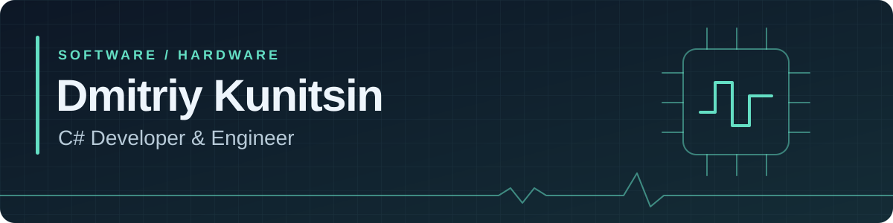

  

  <b>Разрабатываю на C# · Работаю с микроконтроллерами · Изучаю FPGA</b>

  
  
  

  

  <a href="#about">Обо мне</a> ·
  <a href="#projects">Проекты</a> ·
  <a href="#education">Образование</a> ·
  <a href="#stack">Технологии</a>

---

## На стыке программного и аппаратного

Я инженер и C#-разработчик. Мой основной фокус — **C# / .NET**; также есть опыт работы с **STM32 и ESP**. Мне интересно, как программный код взаимодействует с физическими устройствами: от обмена данными до их обработки и представления.

Сейчас учусь в магистратуре **Новосибирского государственного университета** и развиваюсь в направлении **FPGA / Zynq**. Ниже — мои инженерные направления, приватные проекты и открытые примеры кода.

| Разрабатываю | Использую на практике | Изучаю и исследую |
| :--- | :--- | :--- |
| C# / .NET | STM32 · ESP | FPGA / Zynq |
| Программные инструменты | Взаимодействие с устройствами | Цифровая логика и потоковые тракты |

   
  Пишу код. Уговариваю железо. Иногда наоборот.

## Проекты и инженерная практика

Большая часть моей работы находится в **приватных репозиториях**. Поэтому публичный GitHub показывает лишь часть опыта: здесь я описываю закрытые направления в общих чертах, а открытые репозитории оставляю как доступные примеры кода.

### Приватные проекты и материалы

| Направление | Задачи и технологии | Доступ |
| :--- | :--- | :--- |
| **Инженерное desktop-ПО** | Работа с C# / .NET Framework, WPF-интерфейсами, обменом данными с устройствами и отображением измерений. | 🔒 Приватный код |
| **Дипломный FPGA / SoC-проект** | Сбор и передача измерительных данных, аппаратно-программное взаимодействие и контроль целостности цифрового потока. В разработке. | 🔒 Приватные материалы |
| **Учебно-исследовательские работы НГУ** | Python, машинное обучение, преобразования сигналов, теория управления, цифровая схемотехника и микроконтроллеры. | 🔒 Основной учебный репозиторий приватный |

Названия закрытых продуктов, внутренние протоколы, схемы и детали реализации не публикую. Дипломное направление и учебные работы не обозначаю как завершённые коммерческие продукты.

### Открытые примеры и учебные проекты

| Проект | Что внутри | Направление | Доступ |
| :--- | :--- | :--- | :--- |
| **[LoggerDIShowcase](https://github.com/DmitriyKunitsin/LoggerDIShowcase)** | Пример организации логирования с NLog и внедрения зависимостей через Autofac. | `C#` `.NET` `DI` | Открытый |
| **[Arduino](https://github.com/DmitriyKunitsin/Arduino)** | Учебные работы с микроконтроллерами в рамках обучения в НГУ. | `C++` `Embedded` | Открытый |
| **[Cyber_guard](https://github.com/DmitriyKunitsin/Cyber_guard)** | Лабораторные работы по информационной безопасности с демонстрациями. | `Python` `Security` | Открытый |

<b>Текущий фокус: FPGA и измерительные данные</b>

Работаю над дипломным проектом в области сбора и передачи измерительных данных на FPGA/SoC.

**Направления работы:** аппаратно-программное взаимодействие, последовательные интерфейсы, организация цифрового потока и проверка целостности данных.

**Статус:** проект в разработке; выполнен начальный аппаратный запуск. Дальнейшая работа — построение и проверка цифрового тракта.

## Образование и практика

**Новосибирский государственный университет · Магистратура**

Совмещаю обучение с инженерной практикой. Учебные материалы и лабораторные работы охватывают программирование, анализ данных и аппаратные системы.

<b>Подробнее об учебных направлениях</b>

- **Машинное обучение и анализ данных** — Python, Jupyter Notebook, работа с данными.
- **Математические преобразования сигналов** — учебные вычисления и эксперименты.
- **Теория автоматического управления** — лабораторные работы.
- **Криптография и информационная безопасность** — учебные алгоритмы и демонстрации.
- **Цифровая схемотехника и архитектура компьютера** — учебные HDL-проекты, простая процессорная архитектура, знакомство с Zynq.

Учебные задания и адаптированные примеры отделяю от собственных разработок и подтверждённых аппаратных результатов.

**Школа 21 · Практика программирования**

Практико-ориентированное обучение программированию.

## Языки и инструменты

### C# / .NET и desktop-разработка

### Другие языки и анализ данных

### Базы данных

### Инструменты и окружение

### Микроконтроллеры

### Сейчас изучаю

Цифровая логика, последовательные интерфейсы, потоковая обработка и аппаратно-программное взаимодействие. FPGA-направление — зона развития, а не заявление о готовой экспертизе во всём перечисленном.

---

  <b>Интересны задачи на стыке .NET, устройств и данных.</b> 
  <a href="https://t.me/seabassc">Обсудить в Telegram</a> · <a href="mailto:kunicind1996@gmail.com">Написать на почту</a>

